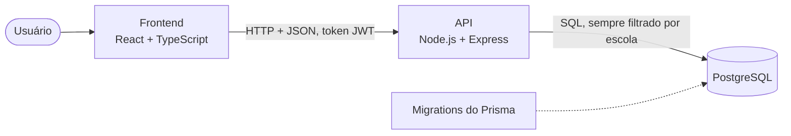

# HajimeTech

Sistema web de gestão e acompanhamento de alunos para academias de judô.

O HajimeTech foi desenvolvido como projeto acadêmico (PI2) para auxiliar na organização de alunos, turmas, frequência, graduações e currículo técnico da academia. O sistema atende mais de uma escola, e cada escola enxerga apenas os próprios dados.

## Sumário

1. [Visão geral](#1-visão-geral)
2. [Objetivo](#2-objetivo)
3. [Funcionamento do currículo](#3-funcionamento-do-currículo)
4. [Funcionalidades](#4-funcionalidades)
5. [Perfis de acesso](#5-perfis-de-acesso)
6. [Arquitetura](#6-arquitetura)
7. [Tecnologias](#7-tecnologias)
8. [Estrutura do repositório](#8-estrutura-do-repositório)
9. [Como executar](#9-como-executar)
10. [Banco de dados](#10-banco-de-dados)
11. [API](#11-api)
12. [Testes e integração contínua](#12-testes-e-integração-contínua)
13. [Identidade visual e acessibilidade](#13-identidade-visual-e-acessibilidade)
14. [Estado do projeto e tarefas](#14-estado-do-projeto-e-tarefas)
15. [Como contribuir](#15-como-contribuir)
16. [Documentação complementar](#16-documentação-complementar)

## 1. Visão geral

O HajimeTech reúne em um só lugar o que a academia precisa acompanhar no dia a dia: quem são os alunos, em que turma treinam, quando vieram, como estão evoluindo no currículo da faixa, quais avaliações e premiações receberam e quais são os indicadores gerais da escola.

| Parte | Descrição | Situação |
|---|---|---|
| Frontend | Aplicação React com todas as telas, ligada à API | Pronto. Tarefas de evolução listadas na seção 14 |
| API | Node.js com Express: autenticação, permissões, regras de negócio e painel | Base pronta. Algumas rotas de gravação são tarefas do grupo (seção 14) |
| Banco de dados | PostgreSQL com migrations do Prisma e dados de demonstração | Pronto |
| Qualidade | Testes de integração com banco de verdade e verificação automática a cada pull request | Pronto, com testes a ampliar junto de cada tarefa |

## 2. Objetivo

Centralizar as principais informações da academia em um sistema web simples, organizado e acessível.

O sistema permite acompanhar:

* alunos cadastrados;
* turmas e horários;
* frequência;
* graduações;
* evolução técnica;
* currículo de cada faixa;
* avaliações de desempenho e premiações;
* indicadores da academia.

## 3. Funcionamento do currículo

O currículo técnico segue uma progressão de faixas:

**Branca, Azul, Amarela, Laranja, Verde, Roxa, Marrom e Preta**

A ideia do sistema é que o aluno aprenda as técnicas correspondentes à sua faixa atual e avance para a próxima faixa após cumprir os conhecimentos definidos pela academia.

Os conteúdos das faixas **Marrom e Preta ainda não estão definidos**, portanto não são inventados pelo sistema. A tela de Currículo mostra o aviso "Conteúdo ainda não definido pela academia", e a API e o banco recusam o cadastro de itens nessas faixas.

O currículo pode ser organizado por categorias, técnicas, ordem das técnicas e ordem das categorias. Somente administradores e professores podem fazer alterações nele.

Outras regras do currículo:

* As faixas Branca a Roxa trazem um currículo de exemplo baseado no Gokyo do Kodokan, que cada academia pode ajustar.
* Técnicas e categorias nunca são apagadas, apenas desativadas, para preservar o histórico dos alunos.
* O perfil de cada aluno mostra uma barra de progresso com a porcentagem de técnicas da faixa atual que ele já domina.

## 4. Funcionalidades

| Módulo | O que oferece |
|---|---|
| Escolas | Lista das academias. Ao selecionar uma escola, todo o sistema passa a mostrar os dados dela |
| Painel | Alunos ativos, presenças, comparecimento e graduações do período, com comparação ao período anterior; frequência semana a semana; alunos por faixa (com as cores reais) e por turma; graduações recentes; destaques e premiações; alunos que mais treinaram. Filtros por período e por turma |
| Alunos | Cadastro, edição, busca por nome (ignora acentos), filtro por turma e faixa, telefone, responsável e observações. "Excluir" desativa o cadastro sem apagar o histórico |
| Perfil do aluno | Dados, frequência, histórico de graduações, técnicas por nível, avaliações, premiações, jornada de faixas e progresso no currículo |
| Turmas | Cadastro com faixa etária, professor responsável e vários horários por semana |
| Frequência | Chamada por turma e data, com marcação de presença e falta e correção de chamadas anteriores |
| Graduações | Registro da troca de faixa (a faixa anterior é guardada e a atual é atualizada) e histórico |
| Acompanhamento técnico | Nível de cada aluno em cada técnica: Iniciante, Em desenvolvimento ou Domina, com observações |
| Currículo | Categorias e técnicas por faixa, com criação, edição, desativação e ordenação |
| Avaliações | Notas de 1 a 5 nos critérios da academia (Técnica, Disciplina, Frequência e Evolução), observações e gráfico de evolução |
| Premiações | Tipos de premiação (destaque do mês, frequência, campeonato, evolução) e concessão aos alunos, exibidas no perfil e no painel |
| Relatórios | Indicadores do painel em tabelas, distribuição por faixa e por turma, frequência semanal, graduações e premiações, com opção de impressão ou PDF |
| Minha evolução | Área do aluno, somente leitura, com a própria evolução |

## 5. Perfis de acesso

| Perfil | Escopo |
|---|---|
| Administrador | Acessa todas as escolas. Gerencia escolas, currículo e todos os cadastros |
| Professor | Acessa a própria escola. Gerencia alunos, turmas, frequência, graduações, currículo, avaliações e premiações |
| Aluno | Acessa a própria escola, somente leitura: "Minha evolução" e o currículo |

O acesso é feito com email e senha, e a API emite um token JWT. As permissões são verificadas pelo servidor em toda requisição; o front apenas esconde o que o perfil não pode usar. A matriz completa está em [`REQUISITOS.md`](REQUISITOS.md).

## 6. Arquitetura



* **Frontend em camadas:** as telas não acessam a API diretamente. Toda chamada passa por `frontend/src/services`, e os tipos de cada entidade ficam centralizados em `frontend/src/types`.
* **API com escopo por escola:** todas as rotas de dados seguem o formato `/api/escolas/:escolaId/...`, e um middleware confere se o usuário pode acessar aquela escola.
* **Banco versionado:** o modelo fica em `backend/prisma/schema.prisma`, e cada mudança gera uma migration. Restrições, chaves compostas por escola e gatilhos garantem a integridade dos dados.

Os desenhos completos (camadas do front, caminho de uma requisição, permissões, modelo de dados e ambiente) estão em [`docs/arquitetura.md`](docs/arquitetura.md).

## 7. Tecnologias

| Camada | Tecnologias |
|---|---|
| Frontend | React 19, Vite, TypeScript, React Router, Recharts, Lucide React, CSS Modules |
| Backend | Node.js, Express, driver `pg`, JSON Web Token, bcrypt |
| Banco de dados | PostgreSQL 16, Prisma (migrations) |
| Testes | Jest, Supertest |
| Infraestrutura | Docker Compose, GitHub Actions |
| Versionamento | Git e GitHub |
| Deploy previsto | Render |

## 8. Estrutura do repositório

```text
HajimeTech/
├── README.md                 Visão geral do projeto (este arquivo)
├── REQUISITOS.md             Requisitos funcionais, não funcionais, regras de negócio e permissões
├── docs/
│   ├── arquitetura.md        Desenhos da arquitetura e decisões de projeto
│   └── issues/               Dicionário de issues: índice e uma ficha por issue
├── .github/
│   ├── workflows/ci.yml      Verificação automática a cada pull request
│   └── ISSUE_TEMPLATE/       Modelos de issue (tarefa e bug)
├── frontend/
│   ├── scripts/gerar-seed.ts Gera database/seed.sql a partir dos dados de demonstração
│   └── src/
│       ├── pages/            Uma página por tela
│       ├── components/       Layout, gráficos, perfil do aluno e componentes de interface
│       ├── contexts/         Sessão, escola selecionada e avisos
│       ├── services/         Chamadas à API (único acesso das telas aos dados)
│       ├── types/            Tipos de domínio
│       ├── utils/            Formatação e matriz de permissões
│       ├── styles/           Tokens de design e estilos globais
│       └── mocks/            Dados de demonstração (fonte do seed.sql)
├── backend/
│   ├── prisma/               Modelo de dados e migrations
│   ├── src/
│   │   ├── routes/           Rotas por domínio
│   │   ├── middleware/       Autenticação, perfis e escopo por escola
│   │   └── lib/              Erros, validações e conversão de formato
│   ├── tests/                Testes unitários e de integração
│   └── client.http           Exemplos de requisições para o VS Code
└── database/
    ├── docker-compose.yml    PostgreSQL de desenvolvimento com migrations e seed
    └── seed.sql              Dados de demonstração
```

## 9. Como executar

### Requisitos

* [Node.js](https://nodejs.org/) 20 ou superior e npm
* [Docker Desktop](https://www.docker.com/products/docker-desktop/), ou um PostgreSQL 14 ou superior instalado
* Navegador atualizado

O front busca todos os dados na API, então os três serviços precisam estar em execução, nesta ordem.

### 1. Banco de dados

```bash
cd database
docker compose up -d
```

O PostgreSQL sobe na porta 5433 já com as tabelas e os dados de demonstração.

### 2. API

```bash
cd backend
npm install
cp .env.example .env
npm run dev
```

A API fica disponível em `http://localhost:3000/api`.

### 3. Frontend

```bash
cd frontend
npm install
cp .env.example .env
npm run dev
```

Acesse `http://localhost:5173`. No PowerShell, use `copy` no lugar de `cp`.

### Usuários de demonstração

Todos entram com a senha `hajime123`.

| Usuário | Email | Perfil | Escola |
|---|---|---|---|
| Coordenação HajimeTech | `admin@hajimetech.local` | Administrador | Todas |
| Sensei Ana Paula Ribeiro | `ana@hajime.local` | Professor | Academia Hajime |
| Prof. Rafael Souza | `rafael@hajime.local` | Professor | Academia Hajime |
| Sensei Marcos Tanaka | `marcos@kizuna.local` | Professor | Dojo Kizuna |
| Lucas Oliveira | `lucas@aluno.local` | Aluno | Academia Hajime |
| Yuki Tanaka | `yuki@aluno.local` | Aluno | Dojo Kizuna |

O administrador começa na tela Escolas e escolhe qual acessar. Professores e alunos entram direto na própria escola. Para voltar aos dados originais, recrie o banco com `docker compose down -v` seguido de `docker compose up -d`.

### Comandos úteis

| Onde | Comando | O que faz |
|---|---|---|
| `frontend` | `npm run build` | Verifica os tipos e gera a versão de produção |
| `frontend` | `npm run gerar-seed` | Regera `database/seed.sql` a partir dos dados de demonstração |
| `backend` | `npm test` | Roda os testes |
| `backend` | `npm run db:migrate` | Cria e aplica uma migration a partir do `schema.prisma` |
| `backend` | `npm run db:deploy` | Aplica as migrations pendentes |
| `backend` | `npm run db:seed` | Carrega os dados de demonstração em um banco vazio |

## 10. Banco de dados

* O modelo oficial é `backend/prisma/schema.prisma`, versionado em `backend/prisma/migrations`.
* Toda tabela de dados tem `escola_id`, e chaves estrangeiras compostas impedem que um registro aponte para dados de outra escola.
* Exclusões são lógicas (coluna `ativo`): alunos, turmas, técnicas, categorias, escolas e premiações não são apagados.
* Um gatilho no banco impede currículo nas faixas sem conteúdo definido.
* O `database/seed.sql` é gerado por script e usa datas relativas ao dia em que é carregado, para o painel sempre mostrar dados recentes. Não deve ser editado à mão.

Diagrama entidade e relacionamento, dicionário de dados e instruções detalhadas: [`database/README.md`](database/README.md).

## 11. API

API REST em Node.js com Express. As consultas são feitas em SQL com o driver `pg`, e o Prisma cuida das migrations.

Garantias aplicadas pelo servidor:

* **Autenticação:** login com email e senha e token JWT. Toda rota, exceto o login, exige o token.
* **Isolamento por escola:** professor e aluno acessam apenas a própria escola. Registros de outra escola respondem como inexistentes.
* **Permissões:** somente o administrador gerencia escolas; administrador e professor editam os cadastros e o currículo; o aluno lê apenas os próprios dados.
* **Regras de negócio:** desativação lógica; graduação sempre para uma faixa superior, guardando a anterior; Marrom e Preta sem currículo; chamada sem registros duplicados; notas de 1 a 5 por critério.
* **Formato padronizado:** respostas em camelCase e erros sempre no formato `{ "erro": "mensagem" }`.

Contrato completo das rotas, exemplos e regras: [`backend/README.md`](backend/README.md). Exemplos prontos para o VS Code: [`backend/client.http`](backend/client.http).

## 12. Testes e integração contínua

| Tipo | O que cobre | Como rodar |
|---|---|---|
| Unitários | Login, sessão, token inválido ou expirado, permissões por perfil e acesso a outra escola | `npm test` em `backend` |
| Integração | Fluxo real com o banco: isolamento entre escolas, perfil aluno, exclusão lógica, currículo, graduações, frequência e painel | `npm test` com a variável `TEST_DATABASE_URL` apontando para o banco do Docker |
| Frontend | Verificação de tipos e build de produção | `npm run build` em `frontend` |

O workflow `.github/workflows/ci.yml` executa tudo isso a cada pull request, com um PostgreSQL próprio. As tarefas pendentes incluem, nos critérios de aceite, os testes da sua parte.

## 13. Identidade visual e acessibilidade

| Elemento | Definição |
|---|---|
| Cores | Vermelho `#C8102E`, azul `#1D4ED8` e `#13306E` e branco, com tons de apoio. Pares de texto e fundo com contraste WCAG AA |
| Faixas | Cores reais do judô, sempre acompanhadas do nome escrito |
| Títulos | Dela Gothic One |
| Textos | Montserrat |
| Logomarca | Yuji Syuku |
| Símbolo | Faixa de judô em movimento ascendente, passando por degraus (as graduações) até um círculo vermelho (a meta) |

A interface é responsiva (no celular, o menu vira uma gaveta) e foi pensada para pessoas sem conhecimento técnico: cada gráfico tem um título simples e uma frase explicando o que mostra. Campos com rótulo, foco visível, mensagens de erro ligadas aos campos e botões com nome acessível fazem parte dos componentes base. Os tokens de design ficam em `frontend/src/styles/tokens.css`.

## 14. Estado do projeto e tarefas

As tarefas ficam nas [issues do GitHub](https://github.com/manroque/HajimeTech/issues), com uma cópia pesquisável em [`docs/issues`](docs/issues/README.md).

**Backend**

| Issue | Tarefa |
|---|---|
| [#15](https://github.com/manroque/HajimeTech/issues/15) | Cadastro, edição e desativação de escolas |
| [#16](https://github.com/manroque/HajimeTech/issues/16) | Edição e desativação de turmas |
| [#17](https://github.com/manroque/HajimeTech/issues/17) | Reordenação de categorias e técnicas do currículo |
| [#18](https://github.com/manroque/HajimeTech/issues/18) | Registro de avaliação de desempenho |
| [#19](https://github.com/manroque/HajimeTech/issues/19) | Tipos de premiação e concessão aos alunos |
| [#13](https://github.com/manroque/HajimeTech/issues/13) | Rotas de usuários, troca de senha e critérios de avaliação |

**Frontend**

| Issue | Tarefa |
|---|---|
| [#10](https://github.com/manroque/HajimeTech/issues/10) | Navegação por teclado nas abas e seletores de opção |
| [#12](https://github.com/manroque/HajimeTech/issues/12) | Definir um único gerenciador de pacotes (npm ou pnpm) |
| [#14](https://github.com/manroque/HajimeTech/issues/14) | Testes automatizados do front |
| [#20](https://github.com/manroque/HajimeTech/issues/20) | Tela de usuários |
| [#21](https://github.com/manroque/HajimeTech/issues/21) | Edição dos critérios de avaliação |
| [#22](https://github.com/manroque/HajimeTech/issues/22) | Troca de senha |

**Também a definir pela academia:** o conteúdo do currículo das faixas Marrom e Preta e a revisão do currículo de exemplo das demais faixas.

## 15. Como contribuir

1. Escolha uma issue aberta e atribua a você.
2. Crie uma branch a partir da `main` com um nome descritivo, por exemplo `feat/cadastro-escolas`.
3. Siga os critérios de aceite da issue, incluindo os testes.
4. Abra um pull request citando a issue (`Closes #15`). O CI precisa passar antes da revisão.
5. Atualize a ficha da issue em `docs/issues` quando ela for concluída.

Para registrar uma nova tarefa, use os modelos "Tarefa" ou "Bug" ao abrir a issue.

## 16. Documentação complementar

| Documento | Conteúdo |
|---|---|
| [`docs/arquitetura.md`](docs/arquitetura.md) | Desenhos da arquitetura e decisões de projeto |
| [`REQUISITOS.md`](REQUISITOS.md) | Requisitos funcionais e não funcionais, regras de negócio e permissões |
| [`backend/README.md`](backend/README.md) | Contrato da API, regras do servidor, como rodar e testar |
| [`database/README.md`](database/README.md) | Modelo de dados, diagrama e instruções do banco |
| [`docs/issues/README.md`](docs/issues/README.md) | Índice de todas as issues |
