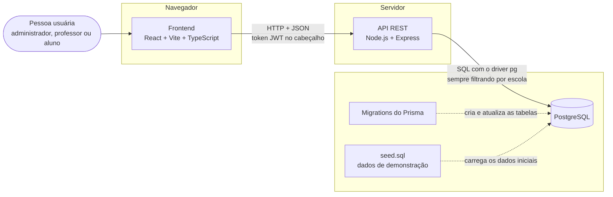
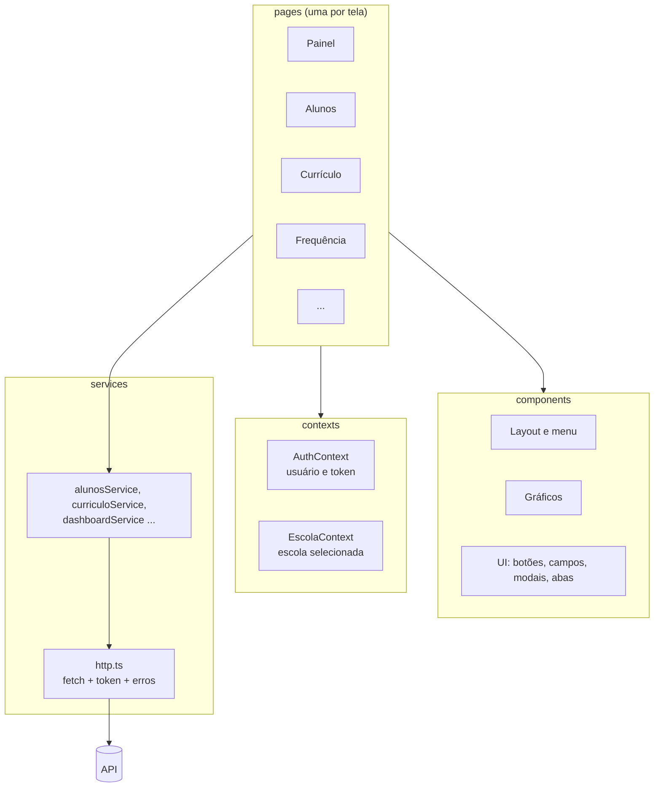
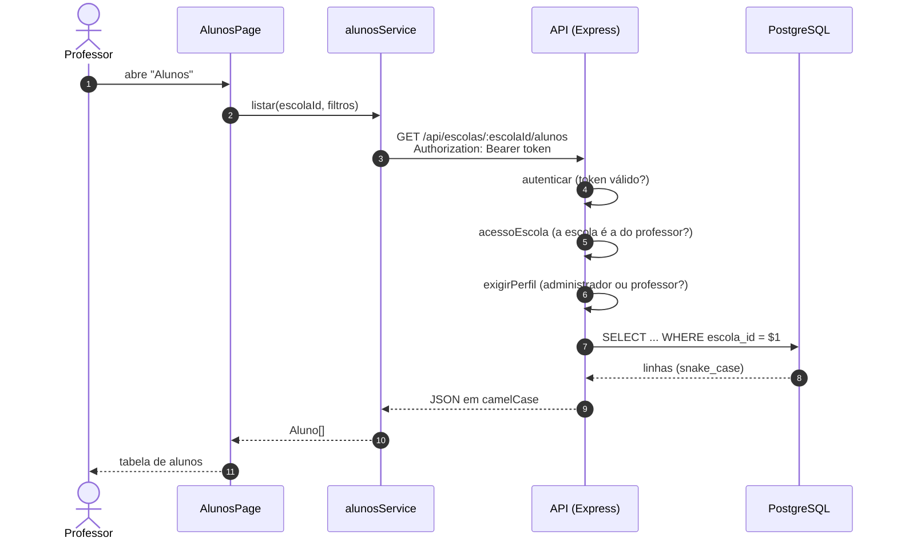
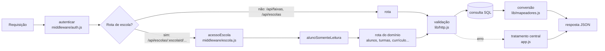
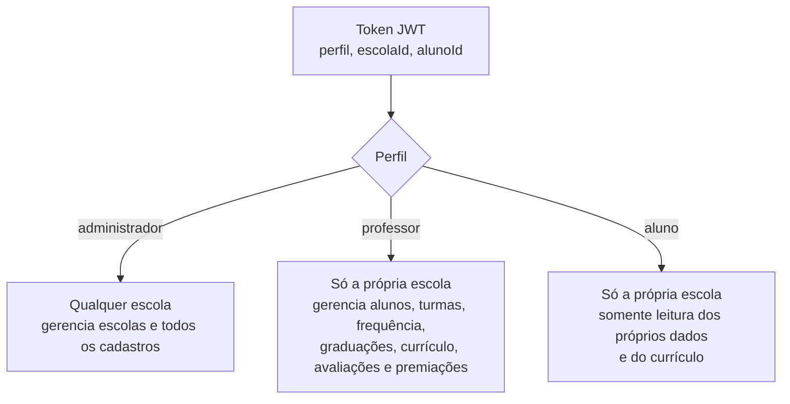
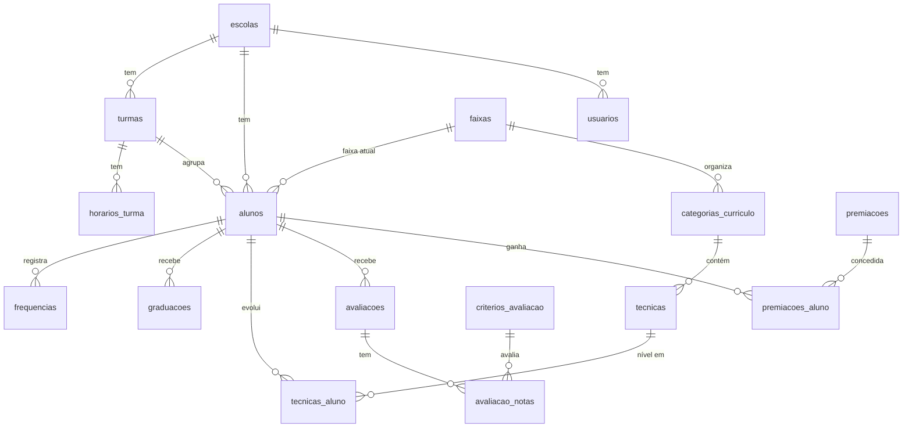
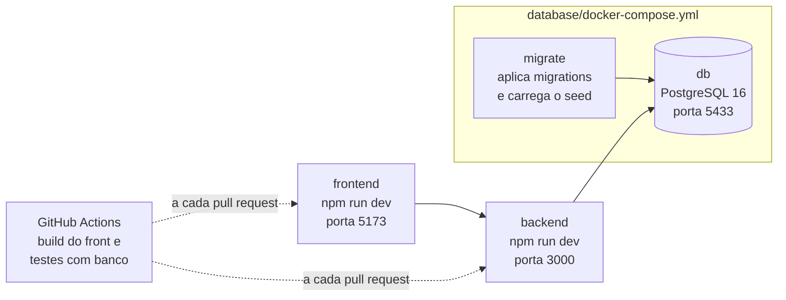

# Arquitetura do HajimeTech

Este documento mostra, com desenhos, como o sistema funciona e por que ele foi organizado assim. Os diagramas usam Mermaid e aparecem desenhados direto no GitHub.

## 1. Visão geral

O HajimeTech tem três partes que conversam em sequência: a interface no navegador, a API e o banco de dados.

| Parte | Responsabilidade | Onde fica |
|---|---|---|
| Frontend | Mostrar as telas, validar formulários, esconder o que o perfil não pode usar | `frontend/` |
| API | Autenticar, conferir permissões, aplicar as regras de negócio, calcular o painel | `backend/src` |
| Banco | Guardar os dados com integridade (chaves, restrições e gatilhos) | `backend/prisma` e `database/` |

**Decisão principal:** a segurança fica no servidor. O front esconde botões para deixar a tela mais simples, mas quem decide se uma ação é permitida é sempre a API. Assim, mesmo que alguém chame a API direto, as regras continuam valendo.

## 2. Como o front foi pensado

O front foi construído em camadas, para cada parte ter uma única responsabilidade e para ser possível desenvolver as telas antes da API existir.

**Princípios que guiaram o front**

1. **As telas nunca chamam a API direto.** Toda busca de dados passa por uma função de `services`. Isso permitiu criar as telas primeiro, com dados simulados, e depois trocar só o corpo dessas funções pelas chamadas reais, sem mexer em nenhuma tela.
2. **Tipos em um só lugar.** `frontend/src/types/index.ts` descreve cada entidade (Aluno, Turma, Graduação...) igual ao banco, em camelCase. Se o formato mudar, o TypeScript aponta todos os lugares afetados.
3. **Escola selecionada como contexto.** Todas as telas leem a escola do `EscolaContext` e a repassam aos services. É assim que o sistema funciona com várias academias.
4. **Permissões declaradas numa tabela.** `utils/permissoes.ts` diz o que cada perfil pode fazer. As telas perguntam `pode('editarCurriculo')` em vez de repetir regras.
5. **Componentes de interface reaproveitados.** Botões, campos, modais, abas e cartões ficam em `components/ui`, com acessibilidade embutida (rótulos, foco visível, navegação por teclado). Cada tela só monta as peças.
6. **Pensado para quem não é da área.** Cada gráfico tem título simples e uma frase explicando o que mostra, os números grandes comparam com o período anterior e as faixas aparecem com a cor real e o nome escrito.
7. **Identidade visual em tokens.** Cores, fontes e espaçamentos ficam em `styles/tokens.css`, para manter o padrão vermelho, azul e branco em todas as telas.

## 3. Caminho de uma requisição

Exemplo: o professor abre a tela de Alunos.

Se qualquer verificação falhar, a API responde `{ "erro": "mensagem" }` com o status certo (401, 403, 404...), e a tela mostra a mensagem. Em caso de 401, o front volta para o login.

## 4. Organização da API

**Decisões da API**

* **Rotas aninhadas por escola** (`/api/escolas/:escolaId/...`): o escopo fica explícito na URL e é conferido em um único middleware.
* **SQL direto com `pg` e Prisma só para migrations:** as consultas ficam visíveis e simples de ler; o Prisma garante o versionamento do banco.
* **Erros centralizados:** as rotas lançam `ErroHttp` e o `app.js` monta a resposta, sempre no mesmo formato.
* **Transações** nas operações compostas (graduação, chamada, turma com horários), para nunca gravar pela metade.

## 5. Perfis e permissões

## 6. Modelo de dados (resumo)

Todas as tabelas de dados têm `escola_id`. Chaves estrangeiras compostas impedem que um registro aponte para dados de outra escola. O modelo completo, com todas as colunas, está em [`database/README.md`](../database/README.md).

## 7. Ambiente de desenvolvimento

## 8. Onde mexer para cada tipo de mudança

| Quero... | Arquivos |
|---|---|
| Criar uma tela | `frontend/src/pages`, rota em `AppRoutes.tsx`, item de menu em `components/layout/AppLayout.tsx` |
| Buscar ou gravar um dado novo | Função em `frontend/src/services` e rota em `backend/src/routes` |
| Mudar uma regra de permissão | `backend/src/middleware` (servidor) e `frontend/src/utils/permissoes.ts` (tela) |
| Mudar o banco | `backend/prisma/schema.prisma` e uma migration nova (`npm run db:migrate`) |
| Mudar os dados de demonstração | `frontend/src/mocks` e `npm run gerar-seed` |
| Mudar cores ou fontes | `frontend/src/styles/tokens.css` |
